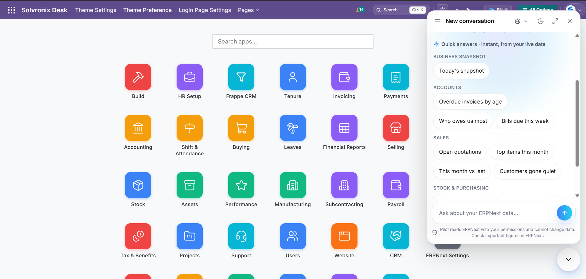
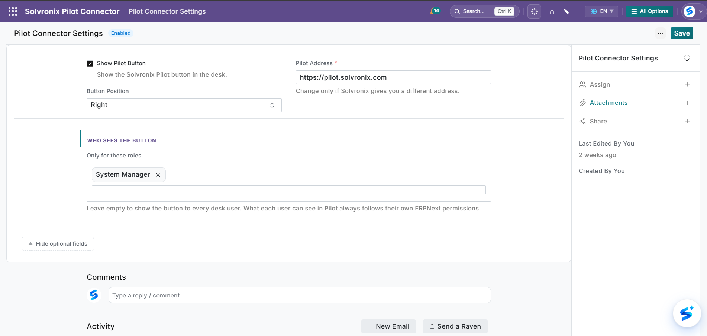
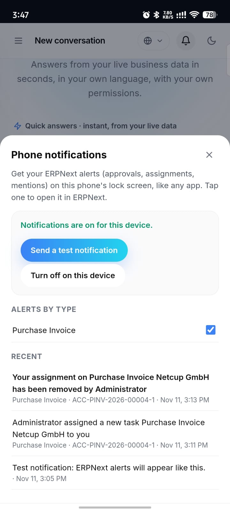

## Solvronix Pilot Connector

Adds the **Solvronix Pilot** assistant button to every ERPNext desk page, so your team can ask questions about your ERPNext data without leaving the screen they're on.

- **Read-only.** The connector only loads the Pilot button. It doesn't create, change or delete anything in ERPNext, and Pilot itself only reads ERPNext with each user's own permissions.
- **Small.** One settings page (Pilot Connector Settings) and a health check that Pilot uses to show "Installed" in the owner console.
- **Phone alerts, no setup.** When phone notifications are on in the Pilot console, the connector tells Pilot about each new ERPNext notification (the bell). It sends only the notification's name and recipient. Pilot reads the alert back with that person's own login and shows it on their phone.
- **Short address.** `your-erpnext-address/pilot` opens Pilot for your company, which is handy on phones.
- **Needs a Pilot account.** Connect your ERPNext at [pilot.solvronix.com](https://pilot.solvronix.com) first. The button opens Pilot for your site.

Requires ERPNext / Frappe **version 16**. Version 15 support is planned.

### Screenshots

**Ask about your data without leaving the page.** The Pilot panel opens over any desk page, with quick answers for your role.



**Choose who sees the button.** Pilot Connector Settings: on or off, position, and roles.



**ERPNext alerts on your phone.** Assignments, mentions and approvals arrive like any app's notifications.



### Install on your own server

Run as the bench user on your ERPNext server:

```bash
cd ~/frappe-bench
bench get-app https://github.com/Solvronix/Solvronix-Pilot-Connector --branch version-16
bench --site your-site.example.com install-app solvronix_pilot_connector
bench restart
```

Branch `version-16` is for Frappe/ERPNext v16 (`main` has the same code).

Reload ERPNext once. The Pilot button appears at the bottom of each desk page, and the Pilot owner console (step 3) shows **Installed**.

### Frappe Cloud

One-click install from the Frappe Cloud Marketplace is coming soon. Until then, contact sales@solvronix.com and we install it for you.

### Settings

In ERPNext, open **Pilot Connector Settings** (System Manager only):

| Setting | What it does |
|---|---|
| Enabled | Show or hide the Pilot button for everyone. |
| Position | Button at the bottom right or bottom left. |
| Pilot Address | Leave as `https://pilot.solvronix.com`. |
| Allowed Roles | Only users with one of these roles see the button. Empty means every desk user. |

Who may actually use Pilot is also set in the Pilot owner console. Nobody gets new access through the button: Pilot always uses the user's own ERPNext permissions.

### Update

```bash
cd ~/frappe-bench/apps/solvronix_pilot_connector && git pull && cd ~/frappe-bench
bench --site your-site.example.com migrate
bench build --app solvronix_pilot_connector
bench restart
```

### Uninstall

```bash
bench --site your-site.example.com uninstall-app solvronix_pilot_connector
bench restart
```

### Versions

| Version | Date | Highlights |
|---|---|---|
| **0.1.7** | 2026-11-12 | Button settings apply without a reload |
| **0.1.6** | 2026-11-11 | Ready for the Frappe Cloud Marketplace (Frappe 16) |
| 0.1.5 | 2026-11-11 | Phone alerts without setup; `your-erpnext-address/pilot` short address |
| 0.1.4 | 2026-11-11 | Button code ships inside the app; fresh installs work straight away |
| 0.1.2 | 2026-11-06 | Install steps and first tests |
| 0.1.1 | 2026-11-06 | First release: Ask Pilot button, settings, health check |

Full details are in [CHANGELOG.md](CHANGELOG.md). Releases and tags: [GitHub Releases](https://github.com/Solvronix/Solvronix-Pilot-Connector/releases).

### Support

[pilot.solvronix.com/docs](https://pilot.solvronix.com/docs) · sales@solvronix.com

### License

MIT
